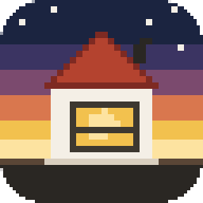
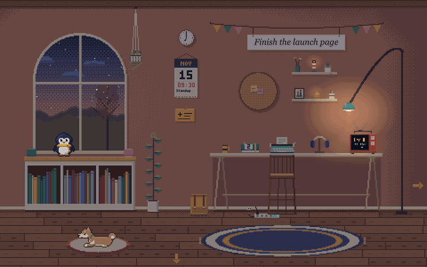

<p align="center">
  
</p>

<h1 align="center">Casa</h1>

<p align="center"><b>Make your second brain feel like home.</b><br>A pixel room for your Obsidian vault.</p>

<p align="center">
  
</p>

Casa reads your notes and draws them as a room you can glance at: today's goal on the banner, your tasks in the agenda, your calendar on the wall and the real weather in the window. Your notes stay as they are: no new syntax, no other plugin needed.

Casa is free. Desktop only: Mac, Windows and Linux.

> The computer is the coldest thing you own. It is also the only home that followed you through every move. So Casa lives there.
>
> [Read the Casa manifesto](https://adrianofontanari.com/designing-meaningful-products) · [casa.adrianofontanari.com](https://casa.adrianofontanari.com)

## What it does

- **Today's goal** on the banner, from today's daily note. Click it to write or change it.
- **Tasks you can tick.** The agenda shows today's tasks and the next days. Tick one in Casa and it is ticked in your note.
- **Your calendar** on the wall, from a private calendar link (ICS). Read-only.
- **Weather and air quality** in the window, with the forecast and a webcam view.
- **Seasons and light** that follow your computer's clock and the date.
- **Pebble**, a penguin buddy who keeps you company (hide it before a screen share), and **Biscuit**, a dog who naps and wanders around the room.
- **A TV** with hand-drawn channels: the clock, the weather and little scenes. Turn the knob for the next one.
- **A typewriter** with a new quote every hour, from your own list or a built-in one.
- **Headphones** with a player for lofi music and ambient sounds (sea, rain, fire, birds).
- **Post-its** on the cork board: add, edit, move and remove them.
- **Your battery** on the power strip.

Every object is described in [docs/objects.md](https://github.com/adrianofontanari/casa/blob/main/docs/objects.md).

## Install

1. In Obsidian, open **Settings > Community plugins** and turn on community plugins.
2. Select **Browse**, search for **Casa** and select **Install**.
3. Select **Enable**. The room opens in a new tab the first time.
4. Later, open it from the house icon in the left ribbon (**Open Casa**), or from the command palette: **Casa: Open room** or **Casa: Open room in a new tab**.

New to Obsidian? [Download it here](https://obsidian.md/download) first.

Manual install: download `main.js`, `manifest.json` and `styles.css` from the [latest release](https://github.com/adrianofontanari/casa/releases/latest) into the `.obsidian/plugins/casa/` folder of your vault, then enable Casa. Details: [docs/install.md](https://github.com/adrianofontanari/casa/blob/main/docs/install.md).

## First run

The room appears right away. A small card then walks you through three steps, each one skippable:

1. **Daily notes.** Casa shows where it found your daily notes. **Change folder** opens Obsidian's own folder picker.
2. **City.** Type your city for the weather in the window, or skip: no weather.
3. **Calendar.** **Add my calendar** opens an Obsidian dialog where you paste your private calendar link (ICS).

Links and folders are typed only in Obsidian's own dialogs, never inside the room. You can run the welcome again from **Settings > Casa**. More: [docs/first-run.md](https://github.com/adrianofontanari/casa/blob/main/docs/first-run.md).

## Works without other plugins or templates

Casa needs no other plugin and no template. To find today's note it reads, in this order:

1. your own choice in **Settings > Casa > Daily notes source** (a folder and a date format), if you set one;
2. the core **Daily notes** settings;
3. the **Periodic Notes** settings (daily notes);
4. the **Journals** settings (the first daily journal);
5. a folder that already holds daily notes named `YYYY-MM-DD.md`;
6. otherwise Casa's default: `Daily/YYYY-MM-DD.md`.

The settings files of those plugins are enough: they do not need to be installed or running. If more than one is set up, the one with notes from the last month wins. Casa only reads their settings and never changes them.

## How Casa reads and writes your notes

Casa reads your vault on your computer. It **writes only when you do something in the room**: write a goal, tick, add or edit a task, add, move or remove a post-it, add a quote. Opening the room never creates or changes a note.

**Today's goal.** Casa reads the first of these that holds a value in today's note:

1. a `goal:` property in the frontmatter;
2. the first line under a heading that contains "goal" (else "focus", else "today"), any level, any case;
3. a line `Goal:`, `- Goal:`, `**Goal:**` or `Goal::`.

When you write a goal, Casa updates that line or property in place. If there is none, it adds `## Today's goal` with your line after the frontmatter and the `# title` line, if any. A goal is one line, up to 300 characters.

**Tasks.** The agenda shows:

- every checkbox in today's note (`- [ ]`, `- [x]`, numbered lists and quotes too). Empty checkboxes, cancelled `[-]` tasks and checkboxes inside code blocks are ignored;
- tasks anywhere in the vault with a Tasks plugin date: due `📅 YYYY-MM-DD`, scheduled `⏳ YYYY-MM-DD`. Overdue ones come first, then today's, then the ones done today (`✅`). The next 7 days are on the following pages.

The Tasks plugin is not needed. If it is installed, Casa respects its global filter and lets it tick its own tasks, so recurring tasks roll over.

| You do | Casa writes |
|---|---|
| Tick or untick | `[ ]` becomes `[x]` or back. On a line that already uses Tasks dates, Casa adds or removes `✅ YYYY-MM-DD` |
| Edit | The task's text. The checkbox, dates and block id stay |
| Add | `- [ ] text` under the first heading with "task" or "to do" in today's note; with no such heading, `## Tasks` at the end |

Before writing, Casa checks that the line has not changed since it read it. If it has, nothing is written and the agenda reloads.

**A new daily note** is created only when you write a goal or a task and today's note does not exist. Casa uses your daily notes template if you have one. Otherwise the note starts with `## Today's goal` and `## Tasks`.

**Post-its** live in `Casa/Post-its.md`, created with your first post-it. One bullet per post-it, extra lines indented by two spaces. Colour and place sit in an Obsidian comment, hidden in reading view:

```
- Water the plants %%casa n1a2b yellow 0.20 0.30%%
  and the balcony ones
```

You can edit the note by hand: a bullet without the comment becomes a yellow post-it, and text around the list is kept.

**Quotes** come from `Casa/Quotes.md`, one per line (`Quote - Author` works too). Until that note exists, the typewriter uses 20 built-in public-domain quotes. Your first added quote creates the note with those 20 inside, then adds yours.

**Casa's settings** (your city, links and room preferences) are saved by Obsidian in `.obsidian/plugins/casa/data.json` inside your vault.

## Settings

**Settings > Casa** has calm mode, show buddy, units, music, weather data and your city, the calendar link, the webcam and air quality switches with their links, the daily notes source, and **Run the welcome again**. Every online source has its own off switch. Details: [docs/settings.md](https://github.com/adrianofontanari/casa/blob/main/docs/settings.md).

## Disclosures

### Network use

Casa works offline. It never sends your notes. Each source below has an off switch that means zero requests. Requests are made only for the open room (which pauses when you cannot see it) or when you search for a city, never at startup. Answers are cached: weather 15 minutes, forecast 1 hour, air 30 minutes, calendar 15 minutes, webcam 15 minutes (5 for your own).

| Service | When | What is sent | Why |
|---|---|---|---|
| [Open-Meteo](https://open-meteo.com) Forecast API (`api.open-meteo.com`) | **Weather data** on and a city set | Your city's coordinates | Weather, forecast and daylight. Data under CC BY 4.0: "Weather data by Open-Meteo.com" |
| [Open-Meteo](https://open-meteo.com) Geocoding API (`geocoding-api.open-meteo.com`) | You search for a city, in the welcome or in settings | The name you type | To find your city. Location data based on GeoNames (CC BY 4.0) |
| [Open-Meteo](https://open-meteo.com) Air Quality API (`air-quality-api.open-meteo.com`) | **Air quality** on and a city set | Your city's coordinates | Outdoor air quality. Data from the Copernicus Atmosphere Monitoring Service (see the notice below) |
| Your own air sensor | **Air quality** on and a sensor link set | A request to that link | Indoor air next to the outdoor air |
| Your calendar provider (Google, Outlook, iCloud or other) | A calendar link set | A request to that link (`webcal://` is sent as `https://`) | Your events on the wall calendar |
| NOAA National Data Buoy Center (`www.ndbc.noaa.gov`) | **Webcam** on, no webcam link of yours | A request for the latest BuoyCAM image of station 46026, off San Francisco | The default webcam view in the window. Public domain (U.S. Government work) |
| Your own webcam | **Webcam** on and a webcam link set | A request for that image | Your webcam view in the window |
| This repository's GitHub release [`music-v1`](https://github.com/adrianofontanari/casa/releases/tag/music-v1) (`github.com` and GitHub's download servers) | **Music** on and you press play on a lofi track | A request for that music file | To play it. Ambient sounds are made on your computer and need no network |

Turn every source off (**Weather data**, **Air quality**, **Webcam** and **Music** off, no calendar link) and Casa makes no network request at all.

Air quality notice, as the room shows it (with the current year): Generated using Copernicus Atmosphere Monitoring Service information 2026. Neither the European Commission nor ECMWF is responsible for any use that may be made of the Copernicus information or data it contains.

Casa does not download or run code, and it does not update itself. Updates come only through Obsidian.

### Payments

None. Casa is free and asks for no payment. Its listing category is **Free**.

### Accounts

None. Casa needs no account.

### Ads and self-promotion

Casa shows no ads. Inside the room, clicking the chair or the backpack opens a small static card: **"Coming soon"**, one line about the pack, and a **Join the waitlist** button. The button opens the packs waitlist on [casa.adrianofontanari.com](https://casa.adrianofontanari.com/#notify) in your browser, only if you click it. Nothing is loaded from that site otherwise.

### Files outside your vault

None. Casa reads and writes only inside your vault.

### Telemetry

None. Casa has no client-side telemetry, no analytics and no crash reporting.

## Privacy

- No account, no telemetry, no analytics.
- Your notes are read on your computer and never leave it.
- Nothing leaves your computer except the requests in [Network use](#network-use), and only for the sources you leave on.
- The room never sees your links: calendar, webcam and sensor links are typed in Obsidian's settings or dialogs, and the room only learns whether one is set.
- Your calendar link works like a password: anyone with it can read your calendar. Casa keeps it in its settings file inside your vault, so it travels with your vault if you sync or share it.
- Stop using Casa and your vault is as it was, apart from the goals, tasks, post-its and quotes you wrote.

More: [docs/privacy.md](https://github.com/adrianofontanari/casa/blob/main/docs/privacy.md).

## Coming soon: packs

More rooms and objects are on the way as optional packs. They are not on sale and nothing in Casa asks for payment.

- **Focus** - the desk as a day planner: your day hour by hour, a chair that tells you to stand up, and the backpack with every file in your vault.
- **Orbit** - a personal and professional CRM, built from the people in your notes.
- **Living** - the kitchen, with recipes, trips and a shopping list, and the garden.
- **Lighthouse** - tools for loud days: guided exercises, a daily journal, a breathing light.

Want one email when they are out? [Join the waitlist](https://casa.adrianofontanari.com/#notify). The room in this plugin stays free.

## Desktop only

Casa runs on Obsidian desktop: Mac, Windows and Linux. It does not run on Obsidian mobile.

The room is light on your computer. It pauses whenever you cannot see it: another tab in front, a collapsed sidebar, a minimised window or Obsidian in the background. Calm mode keeps it still even while you look at it.

## Support

- **Bugs:** [GitHub Issues](https://github.com/adrianofontanari/casa/issues).
- **Ideas and questions:** [GitHub Discussions](https://github.com/adrianofontanari/casa/discussions).
- **Help:** [FAQ](https://github.com/adrianofontanari/casa/blob/main/docs/faq.md) and [troubleshooting](https://github.com/adrianofontanari/casa/blob/main/docs/troubleshooting.md).

## Licence

Casa uses the [PolyForm Noncommercial License 1.0.0](https://polyformproject.org/licenses/noncommercial/1.0.0), with one added permission for use at work. Full terms: [LICENSE](https://github.com/adrianofontanari/casa/blob/main/LICENSE). In plain words:

- You can install and use Casa for free, at home and at work.
- You can change Casa and share it, changed or not, for free, as long as you keep the `Required Notice` line that credits the author.
- Selling Casa, or using it in a product or service you charge for, needs a commercial licence: ask through [adrianofontanari.com](https://adrianofontanari.com).
- Music and data from others keep their own licences, listed in the credits.

Casa is source-available, so it is not open source.

## Credits

- Weather data by [Open-Meteo.com](https://open-meteo.com/), under CC BY 4.0. Location data based on GeoNames.
- Air quality: Copernicus Atmosphere Monitoring Service, through Open-Meteo.
- Default webcam: NOAA National Data Buoy Center, BuoyCAM station 46026. Public domain, used under the [weather.gov disclaimer](https://www.weather.gov/disclaimer) terms; no endorsement by NOAA is implied.
- Lofi music by HoliznaCC0, under CC0 1.0.
- Built-in quotes: public-domain texts.

Every source, licence and check date: [docs/dev/credits.md](https://github.com/adrianofontanari/casa/blob/main/docs/dev/credits.md).

## Author

Made by [Adriano Fontanari](https://adrianofontanari.com). Website: [casa.adrianofontanari.com](https://casa.adrianofontanari.com).

Casa is an independent plugin and is not affiliated with Obsidian.
